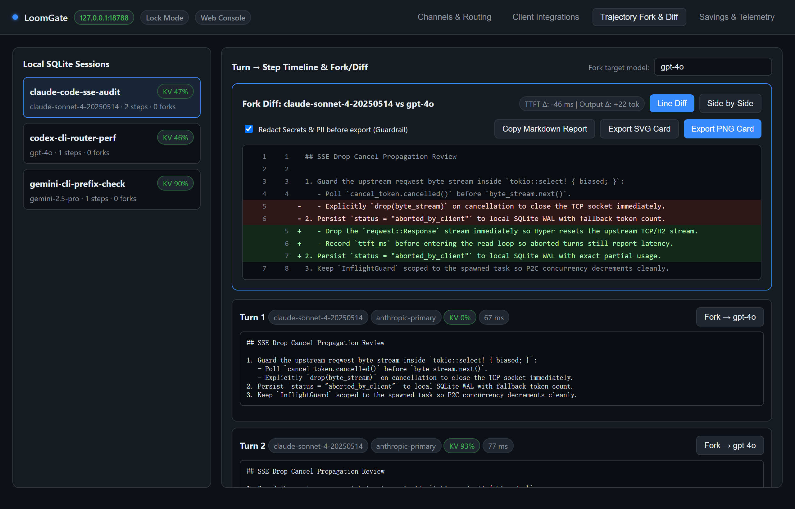
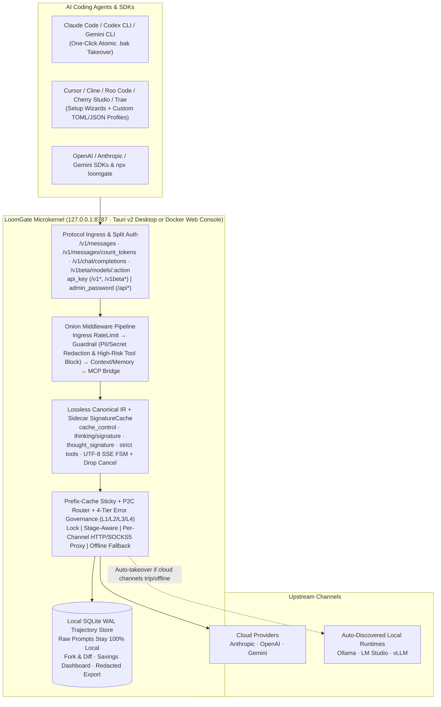
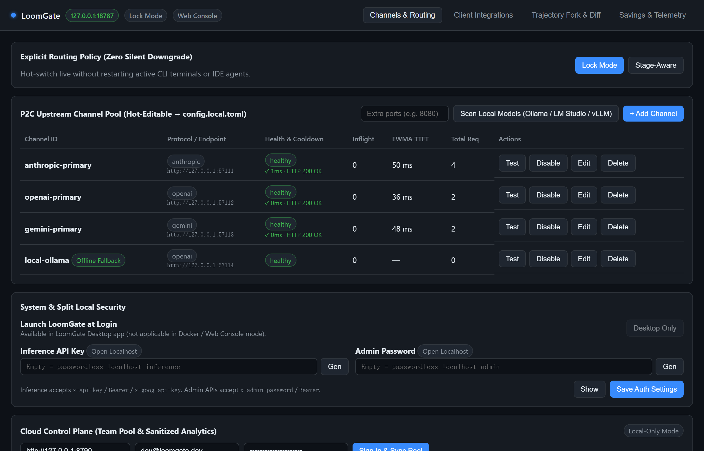
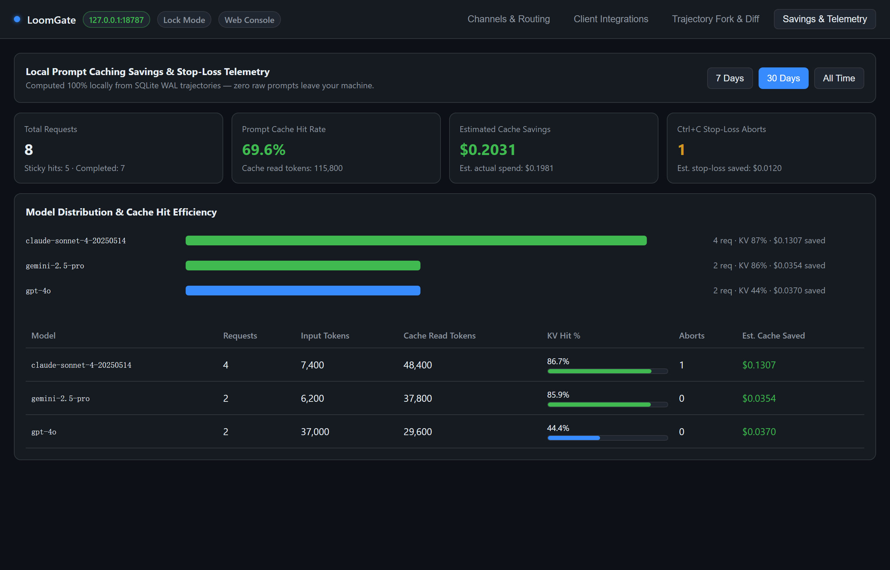

<div align="center">

# LoomGate

**The local-first Rust AI gateway built for Claude Code, Codex CLI, Gemini CLI, and Cursor — stop burning prompt cache, losing thinking signatures, or paying for aborted streams.**

[](https://github.com/yangdw2024/LoomGate/releases)
[](https://github.com/yangdw2024/LoomGate/actions/workflows/ci.yml)
[](https://www.npmjs.com/package/loomgate)
[](https://v2.tauri.app/)
[](LICENSE)

**English** | **[简体中文](README_ZH.md)**

<br />

<!-- Replace with your captured screenshot following docs/assets/SCREENSHOT_GUIDE.md -->


</div>

---

Ordinary API proxies break coding agents in subtle, expensive ways: round-robin load balancing destroys KV prompt cache every turn, protocol translators silently strip `cache_control` or `thought_signature`, `Ctrl+C` leaves upstream streams billing in the background, and you have no way to replay a bad turn on another model.

**LoomGate** is a single Rust microkernel (`gateway-core`) embedded in a lightweight **Tauri v2 desktop app** (and runnable as a **Docker Web Console**) that fixes all four while keeping **100% of your prompts in local SQLite WAL**.

---

## Why LoomGate vs. Ordinary Proxies

| Capability | Direct to Provider | Ordinary Proxy (LiteLLM / One-API) | **LoomGate (`v1.0.0`)** |
|---|:---:|:---:|:---:|
| **Lossless 3-Protocol IR** (`Anthropic` / `OpenAI` / `Gemini`) | Single vendor only | Often drops `cache_control`, `thinking/signature`, `thought_signature`, or `strict` tool schemas | **Lossless Canonical IR + sidecar `SignatureCache`** (auto-rehydrates stripped `thought_signature` across turns) |
| **Prompt-Cache Prefix Affinity** | Tied to 1 key/account | Round-robin / random routing invalidates KV cache across channels | **Turn-1-stable Prefix-Cache Sticky + P2C Router** pins a session to one healthy channel even without `X-Session-Id` |
| **Zero Silent Downgrade** | N/A | Silent fallback can quietly swap models | Explicit **`Lock` mode** (never downgrades) vs **`Stage-Aware`**, with `X-Gateway-Actual-Model` on every response |
| **Mid-Stream `Ctrl+C` Stop-Loss** | Client-dependent | Proxy often drains upstream response after client disconnects | **Zero-buffer UTF-8 SSE FSM with `Drop` cancel propagation** immediately aborts upstream TCP & logs `aborted_by_client` |
| **Claude CLI `/v1/messages/count_tokens`** | Anthropic only | Frequently 404 when routing Claude Code to OpenAI / Gemini | **Native pass-through + deterministic IR fallback** so Claude CLI preflight never fails |
| **Trajectory Replay & Fork/Diff** | None | Centralized request logs only (no branching replay) | **Local SQLite WAL append-only tree**: fork any past turn onto another model, line-level diff, Guardrail-redacted Markdown/SVG/PNG export |
| **Local Offline Fallback** | None | Manual config | **Parallel `<= 350ms` auto-discovery** for Ollama (`:11434`), LM Studio (`:1234`), vLLM (`:8000`) with automatic `offline_fallback` |
| **Privacy Boundary** | Sent to vendor | Centralized proxy server stores full prompts | **100% local SQLite WAL**; optional cloud control plane accepts **SHA-256 hashed IDs & numeric metrics only** |

---

## Architecture



---

## 5-Minute Quick Start

### Step 1: Install & Start LoomGate (`127.0.0.1:8787`)

Pick your preferred runtime (all three execute the same `gateway-core` microkernel):

- **Desktop App (Recommended)** — Download from **[GitHub Releases (`v1.0.0`)](https://github.com/yangdw2024/LoomGate/releases/tag/v1.0.0)**:
  - **Windows**: `LoomGate_1.0.0_x64-setup.exe` (NSIS) or `LoomGate_1.0.0_x64_en-US.msi` (MSI)
  - **macOS (Apple Silicon)**: `LoomGate_1.0.0_aarch64.dmg` (or `LoomGate_aarch64.app.tar.gz`)
  - **Linux**: `LoomGate_1.0.0_amd64.AppImage`, `LoomGate_1.0.0_amd64.deb`, or `LoomGate-1.0.0-1.x86_64.rpm`
  - Open **Channels & Routing** → click **+ Add Channel** (or **Scan Local Models** for Ollama/LM Studio/vLLM) → click **Test**.

- **Docker Compose (Gateway + Built-in Web Console at `http://localhost:8787`)**:
  ```bash
  git clone https://github.com/yangdw2024/LoomGate.git
  cd LoomGate
  docker compose -f deploy/docker-compose.yml up -d
  ```

- **From Source (Rust Daemon)**:
  ```bash
  cp config.example.toml config.local.toml   # Edit with your real base_url & api_key (gitignored)
  GATEWAY_CONFIG=config.local.toml cargo run -p gateway-daemon
  ```

### Step 2: Connect Your Coding Agent (Copy-Paste)

> **Tip**: In **LoomGate Desktop → Client Integrations**, Claude Code, Codex CLI, and Gemini CLI also support **one-click atomic config takeover** with automatic `.edge-gateway.bak` backup and lossless rollback. If you set an `api_key` in LoomGate, replace `local-loomgate` below with your key.

#### Claude Code
```bash
export ANTHROPIC_BASE_URL="http://127.0.0.1:8787"
export ANTHROPIC_AUTH_TOKEN="local-loomgate"
claude
```
*(PowerShell: `$env:ANTHROPIC_BASE_URL="http://127.0.0.1:8787"; $env:ANTHROPIC_AUTH_TOKEN="local-loomgate"; claude`)*

#### Codex CLI
Add to `~/.codex/config.toml` (or click **Take Over** in LoomGate Studio):
```toml
openai_base_url = "http://127.0.0.1:8787/v1"
```
Or via environment variables:
```bash
export OPENAI_BASE_URL="http://127.0.0.1:8787/v1"
export OPENAI_API_KEY="local-loomgate"
```

#### Gemini CLI
```bash
export GEMINI_API_BASE_URL="http://127.0.0.1:8787"
export GEMINI_API_KEY="local-loomgate"
gemini
```

#### Cursor
1. Open **Cursor Settings → Models → OpenAI API Key**.
2. Enable **Override OpenAI Base URL** and set:
   ```text
   http://127.0.0.1:8787/v1
   ```
3. Set API Key to `local-loomgate` (or your configured LoomGate `api_key`).

#### Official npm CLI & TypeScript SDK (`loomgate`)
```bash
npm install loomgate
npx loomgate status
npx loomgate local scan
npx loomgate savings 30
npx loomgate sessions
npx loomgate fork <step_id> gpt-4o
npx loomgate diff-export <orig_step_id> <fork_step_id>
```

---

## Benchmark & Cache Hit Proof (Reproducible Verification)

LoomGate ships two reproducible test harnesses in `tests/` so you can verify sticky cache affinity, mid-stream stop-loss, cross-protocol fidelity, and real-upstream savings yourself.

### 1. Automated 18/18 Conformance & Sticky-Routing Suite (Local Mock Cluster)
Verifies deterministic routing invariants across a 4-channel cluster (Anthropic x2, OpenAI, Gemini) plus Cloud Control Plane:

```bash
# Build workspace binaries & Web Console static bundle
cd apps/desktop && npm ci && npm run build && cd ../..
cargo build -p gateway-daemon -p cloud-control-plane

# Terminal 1: 4-channel mock upstream cluster (18081-18084)
python3 tests/mock_upstream.py

# Terminal 2: Optional cloud control plane (8790)
./target/debug/cloud-control-plane

# Terminal 3: LoomGate edge daemon with Web Console mounted (8787)
GATEWAY_CONFIG=config.example.toml LOOMGATE_WEB_DIST=apps/desktop/dist ./target/debug/gateway-daemon

# Terminal 4: Run all 18 conformance checks
python3 tests/conformance_suite.py
```

Key verified invariants from `tests/conformance_suite.py`:
- **Test 1 (Session Stickiness without `X-Session-Id`)**: 10-turn conversation pins to one channel from Turn 1 (`9/9` sticky hits, 100% affinity).
- **Test 3 (Mid-Stream `Ctrl+C` Cancel Propagation)**: Aborts upstream TCP stream in `< 1s` (`aborted=1, completed=0`) and records `status=aborted_by_client` in SQLite WAL.
- **Test 4 (4-Tier Error Governance)**: L1 in-place backoff retry, L2 cooldown failover, L3 quarantine + affinity unbind, L4 native 400 passthrough.
- **Test 8 & 9 (3-Protocol Interop & `thought_signature` Sidecar Hydration)**: Anthropic ↔ OpenAI ↔ Gemini lossless translation + stripped `thoughtSignature` transparently restored on Turn 2.
- **Test 15 & 16 (Local Auto-Discovery + Savings Aggregation)**: Detects mock Ollama + LM Studio in `< 400ms`, routes offline fallback cleanly, and aggregates cache-read & stop-loss USD savings.

### 2. Live Upstream Cache Hit & Stop-Loss Benchmark (Fill with Your Real Run)
Point `config.local.toml` at your real upstream account(s), start `gateway-daemon`, and run:

```bash
# Start daemon with your local (gitignored) config
GATEWAY_CONFIG=config.local.toml cargo run -p gateway-daemon

# Run live multi-turn caching, tool calling & Ctrl+C stop-loss verification
python3 tests/live_upstream_verify.py \
  --anthropic-model claude-sonnet-4-20250514 \
  --openai-model gpt-4o

# Inspect 30-day local SQLite savings summary
npx loomgate savings 30
```

| Verified Run | Model / Cluster | Sticky Affinity | Tool Calling / Signature | `Ctrl+C` Stop-Loss | Observed Metrics |
|---|---|---:|---|---|---|
| **18/18 Conformance Cluster** (`tests/conformance_suite.py`) | 4-channel cluster (Anthropic x2, OpenAI, Gemini) | **9/9 (100% from Turn 1, no `X-Session-Id`)** | Stripped `thoughtSignature` restored on Turn 2 | `aborted=1, completed=0` (`< 1s` TCP abort) | 33 reqs, **42.2% avg cache hit**, `$0.03486` cache saved, local discovery **356–370 ms** |
| **Live Upstream Run** (`tests/live_upstream_verify.py`) | `claude-sonnet-4-6` (Anthropic `/v1/messages`) | **2/2 (`X-Gateway-Sticky-Hit: true`)** | `tool_calls=1` round-trip passed | Persisted `aborted_by_client` (`$0.012` est. stop-loss) | 11,473 input / 371 output tokens; *note: upstream relay did not report provider KV cache counters* |
| **Live Cross-Protocol Run** (`tests/live_upstream_verify.py`) | `gemini-3.8-flash` (Anthropic → Gemini native) | **`X-Gateway-Sticky-Hit: true`** | 820-byte `thoughtSignature` sidecar hydrated + `tool_use` round-trip | Persisted `aborted_by_client` | Zero schema loss across Anthropic → Gemini native translation |

*(Run `python3 tests/live_upstream_verify.py` against direct Anthropic or OpenAI API keys to observe live provider-reported `cache_read_input_tokens` / `cached_tokens` in your local `Savings & Telemetry` tab.)*

---

## Visual Tour

### P2C Channel Pool, Explicit Lock / Stage-Aware & Local Offline Fallback


### Local Prompt Caching Savings & `Ctrl+C` Stop-Loss Telemetry


---

## Extensions, Security & Contributing

- **Extend LoomGate** (custom `~/.loomgate/client_profiles.toml`, custom Onion `Middleware` Trait, custom `ProtocolCodec` Trait): [`docs/EXTENSIONS.md`](docs/EXTENSIONS.md)
- **Privacy & Security Model** (local SQLite WAL invariant, split `api_key` / `admin_password`, `sessionStorage`-only Web Console auth, Guardrail redaction): [`SECURITY.md`](SECURITY.md)
- **Contributing & Local Green Gates**: [`CONTRIBUTING.md`](CONTRIBUTING.md)
- **Full Release History**: [`CHANGELOG.md`](CHANGELOG.md)

## License

MIT — see [`LICENSE`](LICENSE).
