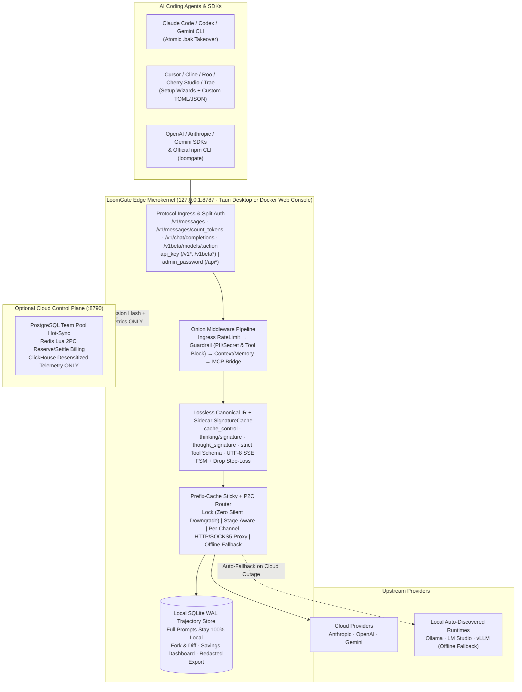

<div align="center">

# LoomGate

**Edge-Cloud Hybrid Microkernel AI Gateway for All AI Agents**

[](https://github.com/yangdw2024/LoomGate/releases)
[](https://github.com/yangdw2024/LoomGate/actions/workflows/ci.yml)
[](https://www.npmjs.com/package/loomgate)
[](https://www.rust-lang.org/)
[](https://v2.tauri.app/)
[](LICENSE)

**English** | **[简体中文](README_ZH.md)**

</div>

---

**LoomGate** is a local-first, Rust-powered **Edge-Cloud Hybrid Microkernel AI Gateway** designed for modern coding agents (**Claude Code, Codex CLI, Gemini CLI, Cursor, Cline / Roo Code, Cherry Studio, Trae**, and any **OpenAI / Anthropic / Gemini SDK**).

One single microkernel runs both your **native Tauri v2 Desktop Studio** and a **Docker-hosted Team Web Console** — delivering **lossless 3-protocol translation**, **Prompt Caching prefix affinity**, **Ctrl+C mid-stream stop-loss**, **onion-model middleware guardrails**, **local Ollama / LM Studio / vLLM offline fallback**, and **SQLite WAL Trajectory Fork & Diff** without ever uploading a single byte of your raw prompts to the cloud.

---

## Architecture



---

## Why LoomGate? (Comparison vs Traditional Proxies)

| Capability | LoomGate v1.0.0 | Traditional HTTP Proxies (One-API / LiteLLM) | Single-Tool Switchers (CC-Switch) |
|---|:---:|:---:|:---:|
| **Lossless 3-Protocol Canonical IR** (`cache_control`, `thinking/signature`, `thought_signature`, `strict` schema) | Native Rust IR + Sidecar Cache | Often dropped or passthrough-only | No cross-protocol IR |
| **Zero Silent Downgrade (`Lock` Mode)** + Explicit Transparent Headers | Strict `Lock` + `X-Gateway-Actual-Model` | Often silent model mapping | Config file swap only |
| **Claude CLI `/v1/messages/count_tokens` Preflight** across OpenAI/Gemini | Built-in native + IR fallback | Frequently 404 on non-Anthropic | N/A |
| **Mid-Stream `Ctrl+C` Stop-Loss** (Drop Cancel Propagation) | Instant TCP abort + WAL audit | Upstream keeps streaming/billing | No data plane |
| **Local Model Auto-Discovery + Offline Fallback** (Ollama / LM Studio / vLLM) | `<= 350ms` parallel scan + 1-click import | Manual YAML/DB setup | No |
| **Trajectory Fork & Diff + Guardrail-Redacted Export** (Markdown / SVG / PNG) | Local SQLite WAL + Canvas 2D Share Card | None | None |
| **One React UI for Both Desktop & Docker Team Console** | Tauri v2 IPC + Browser REST (`sessionStorage`) | Web-only heavy stack | Desktop-only |
| **Local-First Privacy** | Raw prompts stay 100% in local SQLite | Centralized server logs prompts | Local |

---

## 30-Second Quickstart

Choose whichever form fits your workflow — all three run the exact same `gateway-core` microkernel:

### Option A: Native Desktop App (Zero Config)
Download the pre-built installer from **[GitHub Releases](https://github.com/yangdw2024/LoomGate/releases)**:
- **Windows**: `LoomGate_1.0.0_x64-setup.exe` (NSIS) or `.msi`
- **macOS**: `LoomGate_1.0.0_aarch64.dmg`
- **Linux**: `LoomGate_1.0.0_amd64.AppImage` / `.deb` / `.rpm`

Launch **LoomGate Studio** → click **Scan Local Models** or **+ Add Channel** → open **Client Integrations** to take over Claude Code / Codex / Gemini CLI or copy Cursor / Cline / Cherry Studio / Trae presets in one click.

### Option B: Docker Compose (Gateway + Built-in Web Console)
```bash
git clone https://github.com/yangdw2024/LoomGate.git
cd LoomGate
docker compose -f deploy/docker-compose.yml up -d
```
- **Web Control Studio**: open `http://localhost:8787` in your browser (supports `x-admin-password` stored only in ephemeral `sessionStorage` when `admin_password` is enabled).
- **3-Protocol Gateway**: point any client to `http://localhost:8787`.
- **Optional Cloud Control Plane**: add `--profile cloud` to launch `:8790` alongside the gateway.

### Option C: Official npm SDK & CLI (`loomgate`)
```bash
npm install loomgate
# or run CLI commands directly
npx loomgate status
npx loomgate local scan
npx loomgate savings 30
npx loomgate sessions
npx loomgate fork <step_id> gpt-4o
npx loomgate diff-export <orig_step_id> <fork_step_id>
```

---

## Full Client Integration Matrix

Powered by the **Declarative Client Profile Registry** (`crates/gateway-core/src/cli_takeover.rs` & `GET /api/clients`) — extensible via `~/.loomgate/client_profiles.toml` or `.json` with zero Rust code changes:

| Client | Mode | What LoomGate Provides |
|---|---|---|
| **Claude Code** | Atomic Takeover | Patches `~/.claude/settings.json` with `.bak` lossless rollback + `/v1/messages/count_tokens` preflight. |
| **Codex CLI** | Atomic Takeover | Patches `~/.codex/config.toml` atomically with one-click restore. |
| **Gemini CLI** | Atomic Takeover | Patches `~/.gemini/settings.json` with native `thought_signature` sidecar hydration. |
| **Cursor** | Setup Wizard | One-click copy `OPENAI_BASE_URL` & JSON config. |
| **Cline / Roo Code** | Setup Wizard | Anthropic & OpenAI-compatible presets preserving `cache_control`. |
| **Cherry Studio** | Setup Wizard | Unified multi-protocol provider snippet. |
| **Trae** | Setup Wizard | OpenAI-compatible custom endpoint snippet. |
| **Generic SDK** | Setup Wizard | Drop-in env vars for Python / TypeScript / Go / Rust SDKs. |
| **Any Custom Agent** | User TOML / JSON | Drop `~/.loomgate/client_profiles.toml` — see [`docs/EXTENSIONS.md`](docs/EXTENSIONS.md). |

---

## Key Features

- **Pure GUI Channel Pool Management**: Hot-add/edit/toggle/delete/probe channels with automatic `base_url` normalization (strips redundant trailing `/v1` & `/v1beta`), per-channel HTTP/SOCKS5 `proxy_url`, Stage-Aware `fallback_models`, `quota_endpoint` probing, live 429 cooldown countdowns, and atomic persistence to `config.local.toml`.
- **Local Model Auto-Discovery & Offline Fallback**: Parallel `<= 350ms` probe for Ollama (`:11434`), LM Studio (`:1234`), vLLM (`:8000`), and custom ports; import with `offline_fallback = true` so local models seamlessly catch requests if all cloud channels trip or go offline (`X-Gateway-Offline-Fallback: true`).
- **Onion-Model Middleware Pipeline**: Symmetric `pre → terminal → post` layers (`IngressRateLimit` → `Guardrail` secret/PII redaction + high-risk tool interception → `ContextMemory` workspace injection → `McpBridge` `mcp__<server>__<tool>` aggregation).
- **Trajectory Studio 2.0 & Savings Dashboard**: Every turn is persisted locally in SQLite WAL. Replay/fork any historical step onto another model, inspect line-level LCS diffs, view Prompt Caching & Ctrl+C stop-loss USD savings, and export Guardrail-redacted **Markdown reports**, **pure SVG**, or **pure Canvas 2D PNG share cards**.
- **Edge-Cloud Hybrid Control Plane**: Optional `cloud-control-plane` (`crates/cloud-control-plane`) with PostgreSQL schema, Redis Lua atomic two-phase reserve/settle billing, and ClickHouse desensitized analytics.

---

## Privacy & Security Boundaries

1. **Local-First by Architecture**: Full prompts, system instructions, tool calls, and responses live exclusively in your local SQLite WAL database. Cloud telemetry uses a strict schema containing only SHA-256 hashed session IDs and numeric/categorical metrics — and the Cloud Control Plane actively rejects any request carrying raw prompt/response fields.
2. **Split Authentication**: Separate `api_key` (`/v1/*`, `/v1beta/*`) and `admin_password` (`/api/*`, `/__admin/*`), remaining passwordless on localhost when unset.
3. **Export Guardrail**: Markdown reports and PNG/SVG share cards default to `redact_secrets = true`, automatically scrubbing `sk-*`, `Bearer <token>`, `AIza*`, `ghp_*`, `AKIA*`, emails, and phone numbers before export.
4. See [`SECURITY.md`](SECURITY.md) for our complete security model and vulnerability reporting policy.

---

## Extensions & Contributing

- **Extend LoomGate** (custom Agent Profiles, custom `Middleware` plugins, custom `ProtocolCodec` backends): [`docs/EXTENSIONS.md`](docs/EXTENSIONS.md)
- **Contributing & Local Verification Gates**: [`CONTRIBUTING.md`](CONTRIBUTING.md)
- **Release History**: [`CHANGELOG.md`](CHANGELOG.md)

## License

[MIT](LICENSE)
