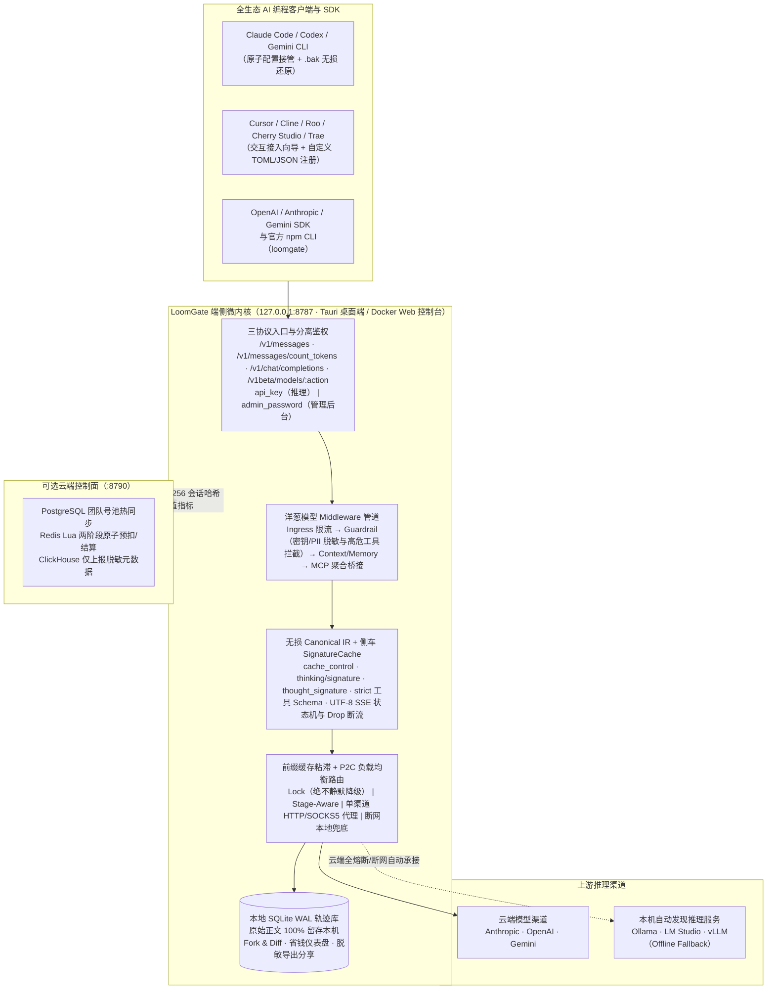

<div align="center">

# LoomGate

**面向全生态 AI Agent 的端云协同微内核 AI 网关**

[](https://github.com/yangdw2024/LoomGate/releases)
[](https://github.com/yangdw2024/LoomGate/actions/workflows/ci.yml)
[](https://www.npmjs.com/package/loomgate)
[](https://www.rust-lang.org/)
[](https://v2.tauri.app/)
[](LICENSE)

**[English](README.md)** | **简体中文**

</div>

---

**LoomGate** 是一个基于 Rust Workspace + Tauri v2 构建的 **本地隐私优先、端云协同微内核 AI 网关**，全面服务 **Claude Code、Codex CLI、Gemini CLI、Cursor、Cline / Roo Code、Cherry Studio、Trae** 以及任意 **OpenAI / Anthropic / Gemini SDK**。

同一套微内核与 React 控制台既能以 **原生 Tauri v2 桌面端** 零配置运行，也能通过 **多阶段 Docker 镜像** 一键部署为团队 Web 控制台——同时提供 **三协议无损双向转换**、**Prompt Caching 前缀亲和路由**、**`Ctrl+C` 流式中途断流止损**、**洋葱模型脱敏/拦截中间件**、**Ollama / LM Studio / vLLM 自动发现与断网兜底**，以及 **本地 SQLite WAL 轨迹回放、Fork & Diff 与省钱仪表盘**，完整 Prompt 与响应正文 100% 留存本地。

---

## 系统架构



---

## 核心能力对比（对比传统代理与单客户端工具）

| 能力维度 | LoomGate v1.0.0 | 传统代理（One-API / LiteLLM） | 单工具切换器（CC-Switch） |
|---|:---:|:---:|:---:|
| **三协议无损 Canonical IR**（`cache_control`、`thinking/signature`、`thought_signature`、`strict` Schema） | Rust 原生 IR + 侧车缓存 | 易静默丢字段或仅裸透传 | 无跨协议转换 |
| **绝不静默降级（`Lock` 模式）** + 透明响应头 | 严格锁定 + `X-Gateway-Actual-Model` | 常存在隐式模型替换 | 仅修改本地配置文件 |
| **Claude CLI `/v1/messages/count_tokens` 预检**（跨 OpenAI / Gemini 上游） | 原生透传 + IR 估算无缝兜底 | 切到非 Anthropic 上游易 404 | 不支持 |
| **`Ctrl+C` 流式中途断流止损**（Drop 传导） | 毫秒级断开上游 TCP + WAL 记账 | 上游继续生成扣费 | 无数据面 |
| **本机模型零配置发现与断网兜底**（Ollama / LM Studio / vLLM） | `<= 350ms` 并行探测 + 一键导入 | 需手动写 YAML / 录入数据库 | 不支持 |
| **轨迹 Fork & Diff + 脱敏导出分享**（Markdown / SVG / PNG） | SQLite WAL + 纯 Canvas 2D 分享图 | 无 | 无 |
| **一套 React 前端跑双端**（桌面原生 + Docker Web 团队控制台） | Tauri v2 IPC + 浏览器 REST（`sessionStorage`） | 仅重型 Web 服务 | 仅桌面端 |
| **本地隐私优先** | 原始 Prompt 仅存本地 SQLite | 中心服务器落盘明文 | 本地 |

---

## 30 秒极速上手

三种形态共享同一套 `gateway-core` 微内核，按需选择：

### 方式一：下载原生桌面安装包（个人开发者推荐，零配置开箱）
前往 **[GitHub Releases](https://github.com/yangdw2024/LoomGate/releases)** 下载对应平台安装包：
- **Windows**：`LoomGate_1.0.0_x64-setup.exe`（NSIS）或 `.msi`
- **macOS**：`LoomGate_1.0.0_aarch64.dmg`
- **Linux**：`LoomGate_1.0.0_amd64.AppImage` / `.deb` / `.rpm`

启动 **LoomGate Studio** → 点击 **Scan Local Models** 自动扫描本机 Ollama / LM Studio / vLLM，或点击 **+ Add Channel** 添加云端渠道并点击 **Test** 测速 → 切到 **Client Integrations** 一键接管 Claude Code / Codex / Gemini CLI 或复制 Cursor / Cline / Cherry Studio / Trae 配置。

### 方式二：Docker Compose 一键部署（三协议网关 + 内置 Web 管理后台）
```bash
git clone https://github.com/yangdw2024/LoomGate.git
cd LoomGate
docker compose -f deploy/docker-compose.yml up -d
```
- **Web 管理控制台**：浏览器直接打开 `http://localhost:8787`（若启用了 `admin_password`，密码仅保存在浏览器 `sessionStorage` 并经 `x-admin-password` 透传，关闭标签页即销毁）。
- **三协议网关入口**：所有客户端直接指向 `http://localhost:8787`。
- **可选云端控制面**：加 `--profile cloud` 同步拉起 `:8790` 团队控制面。

### 方式三：官方零依赖 npm SDK & CLI（`loomgate`）
```bash
npm install loomgate
# 或直接使用 CLI
npx loomgate status
npx loomgate local scan
npx loomgate savings 30
npx loomgate sessions
npx loomgate fork <step_id> gpt-4o
npx loomgate diff-export <orig_step_id> <fork_step_id>
```

---

## 全客户端声明式接入矩阵

基于 **声明式客户端注册表**（`crates/gateway-core/src/cli_takeover.rs` 与 `GET /api/clients`），无需修改 Rust 代码即可通过 `~/.loomgate/client_profiles.toml` 或 `.json` 扩展任意新 Agent：

| 客户端 | 接入方式 | 说明 |
|---|---|---|
| **Claude Code** | 原子接管（自动 `.bak` 还原） | 原子改写 `~/.claude/settings.json`，完整支持 `/v1/messages/count_tokens` 预检。 |
| **Codex CLI** | 原子接管（自动 `.bak` 还原） | 原子改写 `~/.codex/config.toml`，一键无损还原。 |
| **Gemini CLI** | 原子接管（自动 `.bak` 还原） | 原子改写 `~/.gemini/settings.json`，原生支持 `thought_signature` 跨轮回填。 |
| **Cursor** | 接入向导（一键复制） | 生成 `OPENAI_BASE_URL` 与 JSON 配置片段。 |
| **Cline / Roo Code** | 接入向导（一键复制） | 支持 Anthropic / OpenAI 兼容模式，完整保留 `cache_control`。 |
| **Cherry Studio** | 接入向导（一键复制） | 统一三协议聚合供应商模板。 |
| **Trae** | 接入向导（一键复制） | OpenAI 兼容自定义模型接入模板。 |
| **通用 SDK** | 接入向导（一键复制） | Python / TypeScript / Go / Rust 环境变量片段。 |
| **任意自定义 Agent** | 本地 TOML / JSON | 放入 `~/.loomgate/client_profiles.toml`，详见 [`docs/EXTENSIONS.md`](docs/EXTENSIONS.md)。 |

---

## 隐私与安全边界

1. **本地隐私红线**：完整 Prompt、System 指令、工具参数与响应正文仅存储于本地 SQLite WAL；连接云端控制面时仅上报 SHA-256 哈希会话与数值指标，云端接口会主动拒绝携带明文字段的遥测请求。
2. **推理与管理分离鉴权**：`api_key`（保护 `/v1/*`、`/v1beta/*`）与 `admin_password`（保护 `/api/*`、`/__admin/*`）严格隔离，未设置时默认保持本机免密体验。
3. **分享导出默认脱敏**：Fork & Diff 导出 Markdown 报告与 PNG/SVG 分享图默认启用 Guardrail 脱敏（自动清除 `sk-*`、`Bearer <token>`、`AIza*`、`ghp_*`、`AKIA*`、邮箱与手机号）。
4. 完整安全模型与漏洞披露流程见 [`SECURITY.md`](SECURITY.md)。

---

## 生态扩展与社区治理

- **三类泛化扩展指南**（自定义 Agent Profile / `Middleware` Trait 插件 / `ProtocolCodec` Trait 协议）：[`docs/EXTENSIONS.md`](docs/EXTENSIONS.md)
- **贡献指南与本地门禁规范**：[`CONTRIBUTING.md`](CONTRIBUTING.md)
- **版本更新日志**：[`CHANGELOG.md`](CHANGELOG.md)

## 开源协议

[MIT](LICENSE)
