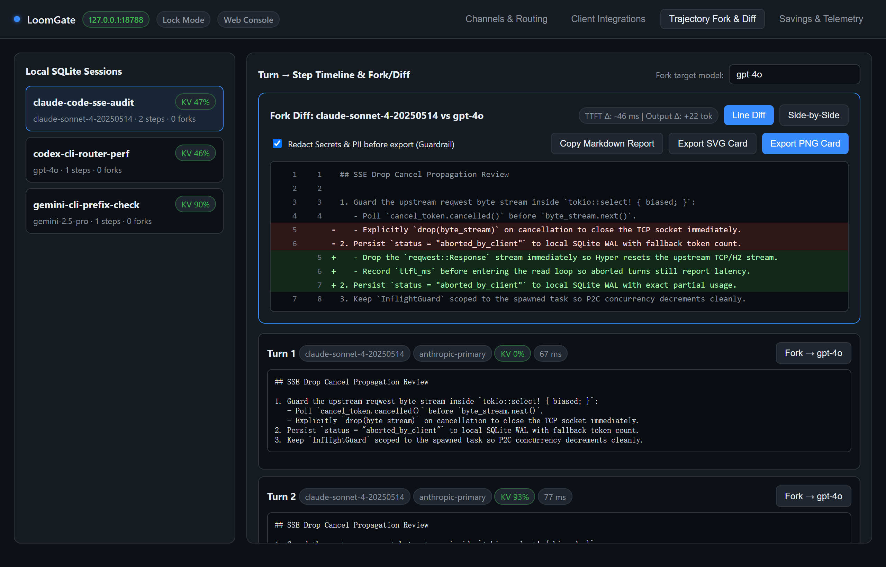
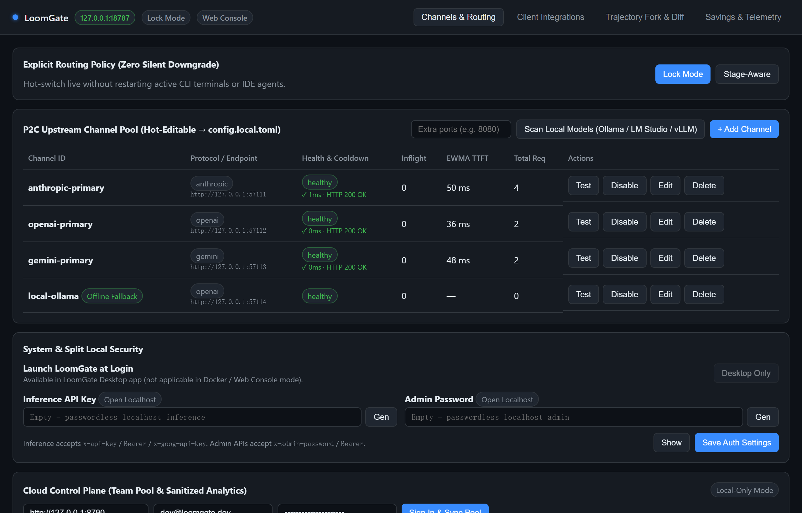
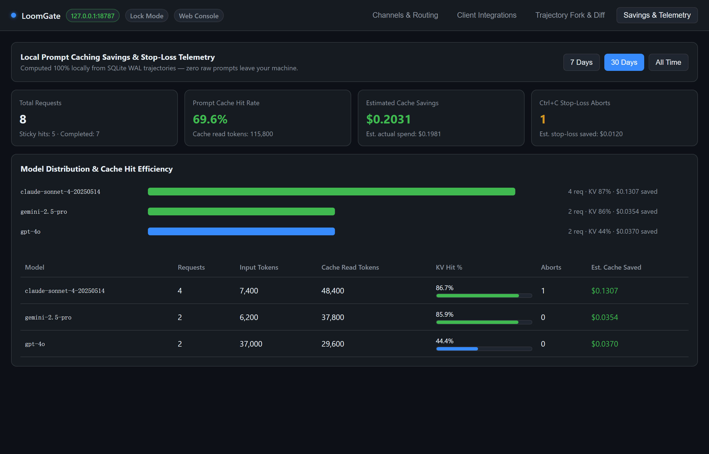

<div align="center">

# LoomGate

**专为 Claude Code、Codex CLI、Gemini CLI 与 Cursor 打造的本地优先 Rust AI 网关——告别 Prompt Cache 反复失效、思考签名丢失与 Ctrl+C 断流白扣费。**

[](https://github.com/yangdw2024/LoomGate/releases)
[](https://github.com/yangdw2024/LoomGate/actions/workflows/ci.yml)
[](https://www.npmjs.com/package/loomgate)
[](https://v2.tauri.app/)
[](LICENSE)

**[English](README.md)** | **简体中文**

<br />

<!-- 按 docs/assets/SCREENSHOT_GUIDE.md 截取高清图后替换 -->


</div>

---

普通中转/API 代理在 AI 编程 Agent 场景下经常暗中踩坑：轮询负载均衡每轮打碎 KV Prompt Cache、跨协议转换静默丢弃 `cache_control` 或 `thought_signature`、终端按 `Ctrl+C` 后上游仍在后台扣费生成、想复盘某一轮换个模型重跑对比却无从下手。

**LoomGate** 采用单一 Rust 微内核（`gateway-core`），一套前端同时运行于 **Tauri v2 原生桌面端** 与 **Docker Web 管理后台**，完整解决上述痛点，且 **100% 原始 Prompt 与响应正文仅留存本地 SQLite WAL**。

---

## 为什么选择 LoomGate？（对比直连与普通代理）

| 核心能力 | 直连模型厂商 | 普通中转/代理（LiteLLM / One-API） | **LoomGate (`v1.0.0`)** |
|---|:---:|:---:|:---:|
| **三协议无损 Canonical IR**（Anthropic / OpenAI / Gemini） | 仅单厂商 | 易丢弃 `cache_control`、`thinking/signature`、`thought_signature` 或 `strict` 工具 Schema | **无损统一 IR + 侧车 `SignatureCache`**（客户端剥离签名也能跨轮自动回填） |
| **Prompt Caching 前缀亲和路由** | 绑定单 Key | 轮询/随机分发导致多渠道 KV 缓存反复失效 | **Turn-1 稳定前缀指纹 + 粘滞 P2C 路由**，无 `X-Session-Id` 也能锁定同渠道 |
| **绝不静默降级** | 不适用 | 失败回退可能静默切换廉价模型 | 显式 **`Lock` 模式**（绝不降级）与 **`Stage-Aware`**，响应必带 `X-Gateway-Actual-Model` |
| **流式 `Ctrl+C` 断流止损** | 视客户端而定 | 客户端断开后代理常继续拉完上游流并扣费 | **零缓冲 UTF-8 SSE 状态机 + Drop 断流传导**，`< 1s` 断开上游 TCP 并记录 `aborted_by_client` |
| **Claude CLI `/v1/messages/count_tokens` 预检** | 仅 Anthropic | 切到 OpenAI / Gemini 上游经常 404 | **原生透传 + Canonical IR 确定性估算兜底**，跨协议零报错 |
| **SQLite WAL 轨迹分叉与 Diff 回溯** | 无 | 仅中心日志，无法按轮分叉重放 | **本地仅追加轨迹树**：任意历史轮次一键 Fork 到其他模型、行级高亮 Diff、默认脱敏导出 Markdown/SVG/PNG |
| **本机模型自动发现与断网兜底** | 无 | 需手工维护配置 | **`<= 350ms` 并行探测** Ollama（`:11434`）/ LM Studio（`:1234`）/ vLLM（`:8000`），云端全熔断自动 `offline_fallback` |
| **隐私边界** | 上送厂商 | 中心化代理服务器落盘完整 Prompt | **原始正文 100% 留存本地 SQLite WAL**；可选云端控制面仅接收 SHA-256 哈希与数值指标 |

---

## 5 分钟极速接入

### 第一步：安装并启动 LoomGate（默认监听 `127.0.0.1:8787`）

- **桌面端安装包（推荐，零配置开箱）** — 前往 **[GitHub Releases (`v1.0.0`)](https://github.com/yangdw2024/LoomGate/releases/tag/v1.0.0)** 下载：
  - **Windows**：`LoomGate_1.0.0_x64-setup.exe`（NSIS）或 `LoomGate_1.0.0_x64_en-US.msi`（MSI）
  - **macOS (Apple Silicon)**：`LoomGate_1.0.0_aarch64.dmg`（或 `LoomGate_aarch64.app.tar.gz`）
  - **Linux**：`LoomGate_1.0.0_amd64.AppImage`、`LoomGate_1.0.0_amd64.deb` 或 `LoomGate-1.0.0-1.x86_64.rpm`
  - 打开 **Channels & Routing** → 点击 **+ Add Channel**（或 **Scan Local Models**）→ 点击 **Test** 测速。
- **Docker Compose（网关 + 内置 Web 管理后台 `http://localhost:8787`）**：
  ```bash
  git clone https://github.com/yangdw2024/LoomGate.git
  cd LoomGate
  docker compose -f deploy/docker-compose.yml up -d
  ```
- **源码启动（Rust Daemon）**：
  ```bash
  cp config.example.toml config.local.toml   # 填入真实 base_url 与 api_key（已被 .gitignore 排除）
  GATEWAY_CONFIG=config.local.toml cargo run -p gateway-daemon
  ```

### 第二步：复制命令接入你的编程 Agent

> 在 **LoomGate Studio → Client Integrations** 页签中，Claude Code / Codex CLI / Gemini CLI 还支持**一键原子接管与 `.bak` 无损还原**。若你配置了 `api_key`，将下方 `local-loomgate` 替换为你的密钥即可。

#### Claude Code
```bash
export ANTHROPIC_BASE_URL="http://127.0.0.1:8787"
export ANTHROPIC_AUTH_TOKEN="local-loomgate"
claude
```

#### Codex CLI
写入 `~/.codex/config.toml`（或在 Studio 点击 **Take Over**）：
```toml
openai_base_url = "http://127.0.0.1:8787/v1"
```
或环境变量：
```bash
export OPENAI_BASE_URL="http://127.0.0.1:8787/v1"
export OPENAI_API_KEY="local-loomgate"
```

#### Gemini CLI
```bash
export GEMINI_API_BASE_URL="http://127.0.0.1:8787"
export GEMINI_API_KEY="local-loomgate"
gemini
```

#### Cursor
1. 打开 **Cursor Settings → Models → OpenAI API Key**。
2. 勾选 **Override OpenAI Base URL** 并填入 `http://127.0.0.1:8787/v1`。
3. API Key 填入 `local-loomgate`（或你配置的 LoomGate `api_key`）。

#### 官方 npm CLI（`loomgate`）
```bash
npm install loomgate
npx loomgate status
npx loomgate local scan
npx loomgate savings 30
npx loomgate sessions
npx loomgate fork <step_id> gpt-4o
npx loomgate diff-export <orig_step_id> <fork_step_id>
```

---

## 可复现验证与省费实测（Benchmark / Cache Hit Proof）

仓库 `tests/` 内置两套可直接复现的验证脚本：

1. **18/18 全量契约与粘滞路由测试（本地 Mock 四渠道集群）**：
   ```bash
   cd apps/desktop && npm ci && npm run build && cd ../..
   cargo build -p gateway-daemon -p cloud-control-plane
   python3 tests/mock_upstream.py &
   ./target/debug/cloud-control-plane &
   GATEWAY_CONFIG=config.example.toml LOOMGATE_WEB_DIST=apps/desktop/dist ./target/debug/gateway-daemon &
   python3 tests/conformance_suite.py
   ```
   覆盖：无 `X-Session-Id` 10 轮 100% 粘滞命中（9/9）、`< 1s` `Ctrl+C` 断流传导、四级错误治理、Anthropic/OpenAI/Gemini 三协议互通与 `thought_signature` 侧车回填、本机模型自动发现与省钱仪表盘聚合。

2. **真实上游缓存命中与止损实测（待填入你的真实账号数据）**：
   ```bash
   GATEWAY_CONFIG=config.local.toml cargo run -p gateway-daemon
   python3 tests/live_upstream_verify.py --anthropic-model claude-sonnet-4-20250514 --openai-model gpt-4o
   npx loomgate savings 30
   ```

| 实测场景 | 模型 / 集群 | 粘滞亲和 | 工具调用 / 思考签名 | `Ctrl+C` 止损落库 | 实测观测结果 |
|---|---|---:|---|---|---|
| **18/18 契约压测集群**（`conformance_suite.py`） | 4 渠道集群（Anthropic x2 / OpenAI / Gemini） | **9/9（无 `X-Session-Id` 第 1 轮起 100% 锁定）** | 剥离 `thoughtSignature` 第 2 轮自动回填 | `aborted=1, completed=0`（`< 1s` 断流） | 33 请求、**42.2% 平均缓存命中**、估算省费 `$0.03486`、本机模型发现 **356–370 ms** |
| **真实上游实测**（`live_upstream_verify.py`） | `claude-sonnet-4-6`（Anthropic `/v1/messages`） | **2/2（`X-Gateway-Sticky-Hit: true`）** | `tool_calls=1` 完整往返 | 落库 `aborted_by_client`（估算止损 `$0.012`） | 11,473 input / 371 output tokens（注：该本地中继上游未透出厂商侧 KV 缓存计数） |
| **真实跨协议实测**（`live_upstream_verify.py`） | `gemini-3.8-flash`（Anthropic → Gemini 原生） | **`X-Gateway-Sticky-Hit: true`** | 820 字节真实 `thoughtSignature` 侧车回填 + `tool_use` 往返 | 落库 `aborted_by_client` | 跨协议零丢字段 |

---

## 界面实拍（Visual Tour）

### P2C 渠道池、Lock / Stage-Aware 热切与本机 Ollama 断网兜底


### 本地 Prompt Caching 省费与 `Ctrl+C` 断流止损仪表盘


---

## 扩展文档与社区治理

- **视觉截图制作指南**：[`docs/assets/SCREENSHOT_GUIDE.md`](docs/assets/SCREENSHOT_GUIDE.md)
- **三类泛化扩展指南**（自定义 Agent Profile / `Middleware` 插件 / `ProtocolCodec`）：[`docs/EXTENSIONS.md`](docs/EXTENSIONS.md)
- **隐私安全模型与漏洞披露**：[`SECURITY.md`](SECURITY.md)
- **贡献指南与门禁规范**：[`CONTRIBUTING.md`](CONTRIBUTING.md)
- **更新日志**：[`CHANGELOG.md`](CHANGELOG.md)

## 开源协议

MIT — 详见 [`LICENSE`](LICENSE)。
